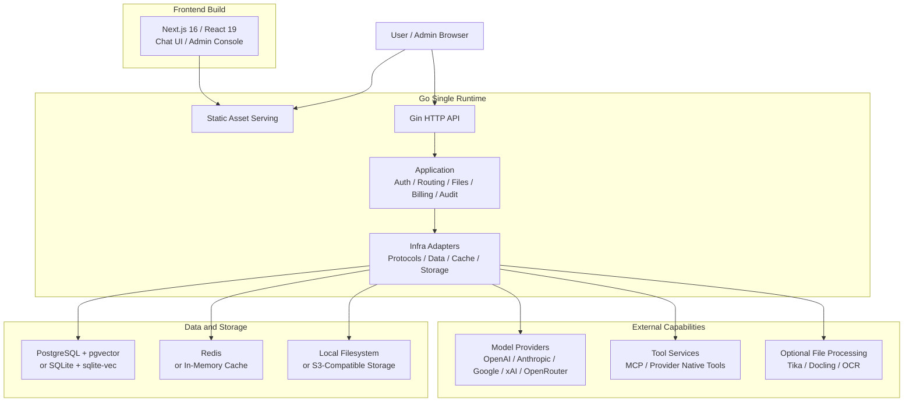

<p align="center">
  
</p>
<h1 align="center">Ivano Chat</h1>

<p align="center">
  基于 <a href="https://github.com/deeix-ai/deeix-chat">DEEIX Chat</a> 二次开发的个人 AI 聊天客户端<br/>
  A personal AI chat client built as a secondary development of DEEIX Chat
</p>

<p align="center">
  <a href="#english">English</a> | <a href="#简体中文">简体中文</a>
</p>

<p align="center">
  
  
  
  
  
</p>

---

<h2 id="english">English</h2>

> This project is documented in both English and Chinese. The Chinese section follows below.

### Overview

Ivano Chat is a personal, self-hosted AI chat client built as a **secondary development of [DEEIX Chat](https://github.com/deeix-ai/deeix-chat)** (v0.4.3, Apache License 2.0).

The goal is to keep the complete account-based platform that the upstream project already provides — registration, login, conversations, history, model routing, files, tools, and billing — and to add one new capability on top: a **guest mode**.

With guest mode, a visitor can start chatting **without registering**. The conversation is stored only in that visitor's own browser and is never written to the server's chat history. Guest usage is metered against the site's public guest budget, with per-visitor quotas, rate limits, and a whitelist of allowed models.

> Ivano Chat is a secondary development based on DEEIX Chat and is independently maintained by Ivano. The original project is licensed under the Apache License 2.0.

### Development status

**This project is in early development.** The current code base is still the upstream DEEIX Chat v0.4.3 baseline: the guest feature is **not implemented yet**, and the running application still behaves like the original DEEIX Chat.

| Stage | Scope | Status |
| --- | --- | --- |
| 0 | Source review and baseline | Baseline review done, pending acceptance |
| 1 | Branding name change | Not started |
| 2 | Guest identity and billing API design | Not started |
| 3 | Guest inference and budget settlement | Not started |
| 4 | Login-page entry and guest chat page | Not started |
| 5 | Browser cache and identity switching | Not started |
| 6 | Admin guest settings | Not started |
| 7 | Regression testing and deployment docs | Not started |

Each stage is implemented, verified, and then explicitly accepted before the next one starts.

### Planned feature: guest mode

Not yet implemented — this is the design target.

- **No registration required.** A visitor clicks "chat as a guest" on the login page and lands on a dedicated `/guest` page.
- **Browser-local conversation.** Messages are stored in IndexedDB on the visitor's own device, expiring 24 hours after the last update. The server does **not** persist message bodies (not in the database, logs, audit trail, or content moderation pipeline).
- **Site-funded.** Guest calls are billed against a dedicated, non-login guest billing principal funded by the site's public guest budget.
- **Metered and rate-limited.** Per-visitor daily budget, generation count, request frequency, and concurrency limits, plus a site-wide daily budget and concurrency cap. Limits are enforced on the server, not merely hidden in the UI.
- **Whitelisted models.** Guests can only use text models explicitly enabled by the administrator.
- **Quota cannot be reset by clearing the browser.** Budgets and counters live on the server; clearing the cache, starting a new chat, or refreshing does not restore quota.

Intentionally **out of scope** for the first version: file upload, knowledge bases and personal memory, MCP and external tools, image/audio/video generation, conversation sharing and cross-device sync, and importing guest chats into an account.

### Retained upstream capabilities

| Area | Capabilities |
| --- | --- |
| Conversations | Multimodal chat with streaming, branches, retries, edits, feedback, sharing, and rich rendering. |
| Models and routing | Platform-model layer for upstream channels, routes, priority, weights, circuit breaking, and capability config. |
| Protocols | Unified OpenAI, Anthropic, Google/Gemini, xAI, OpenRouter, and OpenAI-compatible support. |
| Files and retrieval | Upload, preview, extraction, OCR, storage quota, chunking, embeddings, and semantic retrieval. |
| Tools | MCP servers and provider-native tools with discovery, enablement, limits, and traceability. |
| Billing | Model and tool pricing, subscriptions, top-ups, balances, usage ledgers, Stripe Checkout, and EPay. |
| Identity and security | Local accounts, sessions, 2FA/TOTP, trusted devices, SSO/OIDC/OAuth, and encrypted secrets. |
| Administration | Users, roles, upstreams, models, routes, pricing, usage logs, audit logs, and system events. |
| Deployment | Single-runtime static serving, Docker, SQLite or PostgreSQL, in-memory cache or Redis, S3-compatible storage. |

### Architecture and tech stack

The frontend is built into static assets and served by the Go service, while APIs, authorization, routing, files, and billing run in the same backend runtime. Heavy document extraction and OCR remain optional services.



| Layer | Technologies |
| --- | --- |
| Frontend | Next.js 16, React 19, TypeScript, Tailwind CSS, Shadcn/UI |
| Backend | Go 1.26, Gin, Gorm, Swagger, OpenTelemetry, Zap |
| Data and cache | PostgreSQL, pgvector, SQLite, sqlite-vec, Redis, in-memory cache |
| Files and storage | Local filesystem, S3-compatible object storage |
| File processing | Built-in extractors, Apache Tika, Docling, RapidOCR, Tesseract, cloud OCR adapters |
| Deployment | Docker, Docker Compose |

### Repository layout

```text
.
├── backend/                  # Go API and single-runtime server
│   ├── cmd/server/            # executable entrypoint
│   ├── internal/              # app, application, domain, infra, transport
│   └── docs/                  # generated Swagger artifacts
├── frontend/                 # Next.js App Router and static export
│   ├── app/                   # route entries and layouts
│   ├── features/              # feature-owned UI and client workflows
│   ├── entities/              # reusable business entities
│   ├── shared/                # API, auth, UI, hooks, models, utilities
│   └── public/                # static assets
├── packages/api-contract/     # generated TypeScript API contract
├── docker/                    # optional extraction and OCR services
├── docs/                      # project docs and development records (local, not committed)
├── config*.example.yaml       # deployment profile templates
├── docker-compose*.yml        # deployment profiles
└── Dockerfile                 # frontend + backend production image
```

### Quick start

Prerequisites: Node.js 20.9+ (the Docker image uses Node.js 24), pnpm 10.17.0 via Corepack, Go 1.26.8, and optionally Docker with Compose v2.

```bash
# Local development (default profile uses PostgreSQL + Redis)
cp config.example.yaml config.yaml       # then edit DSN / Redis / public URLs
pnpm install
cp frontend/.env.example frontend/.env.local
pnpm dev
```

Lightweight single-node trial with SQLite and an in-memory cache:

```bash
cp config.sqlite.example.yaml config.yaml
docker compose -f docker-compose.sqlite.yml up -d
```

The app listens on `http://localhost:8080` (frontend dev server on `http://localhost:3000`). Probes: `/healthz`, `/readyz`, `/api/v1/version`. On first startup, if no superadmin exists, the backend prints an initial `admin` password **once** in its logs; the first login forces a credential change.

### Documentation

- Backend guide: [backend/README.md](./backend/README.md)
- Backend standards: [backend/docs/README.md](./backend/docs/README.md)
- Frontend guide: [frontend/README.md](./frontend/README.md)
- API contract package: [packages/api-contract/README.md](./packages/api-contract/README.md)
- Contributing: [.github/CONTRIBUTING.md](./.github/CONTRIBUTING.md)
- Security policy: [.github/SECURITY.md](./.github/SECURITY.md)

### Acknowledgements

Ivano Chat is built on top of [DEEIX Chat](https://github.com/deeix-ai/deeix-chat) and the open-source ecosystem around it: [Next.js](https://nextjs.org), [Go](https://go.dev), and the wider AI tooling community.

### License

Ivano Chat is a secondary development of DEEIX Chat and is distributed under the [Apache License 2.0](./LICENSE). Original copyright and attribution are preserved; see [NOTICE](./NOTICE).

---

<h2 id="简体中文">简体中文</h2>

### 项目简介

Ivano Chat 是一个个人自部署的 AI 聊天客户端，基于开源项目 [DEEIX Chat](https://github.com/deeix-ai/deeix-chat)（v0.4.3，Apache License 2.0）**二次开发**而来。

目标是在完整保留上游已有的账户体系——注册、登录、对话、历史记录、模型路由、文件、工具和计费——的基础上，新增一项能力：**游客模式**。

在游客模式下，访客**无需注册**即可开始聊天。对话仅保存在该访客自己的浏览器中，不写入服务器的聊天历史。游客用量由站点的游客公共预算承担，并受单个访客的额度、频率限制和模型白名单约束。

> Ivano Chat 基于 DEEIX Chat 二次开发，由 Ivano 独立维护。原项目采用 Apache License 2.0。

### 开发状态

**本项目处于开发早期。** 当前代码基线仍是上游 DEEIX Chat v0.4.3，**游客功能尚未实现**，运行中的程序行为与原版 DEEIX Chat 一致。

| 阶段 | 内容 | 状态 |
| --- | --- | --- |
| 0 | 源码核对和基线 | 已完成基线核对，待验收 |
| 1 | 品牌名称修改 | 未开始 |
| 2 | 游客身份和计费接口设计 | 未开始 |
| 3 | 游客推理和预算结算 | 未开始 |
| 4 | 登录页入口和游客聊天页面 | 未开始 |
| 5 | 浏览器缓存和身份切换 | 未开始 |
| 6 | 后台游客设置 | 未开始 |
| 7 | 整体回归和部署文档 | 未开始 |

每个阶段完成后先经过用户验收，再开始下一阶段。

### 规划中的功能：游客模式

尚未实现，以下为设计目标。

- **无需注册。** 访客在登录页点击"以游客身份快速聊天"，进入独立的 `/guest` 页面。
- **对话只存在浏览器。** 消息保存在访客本机的 IndexedDB 中，最后更新后 24 小时过期。服务器**不**持久化对话正文（数据库、日志、审计、内容审核均不含正文）。
- **由站点承担费用。** 游客调用记在一个专用的、不可登录的游客计费主体上，由站点公共预算承担。
- **受限且有额度。** 单个访客的每日预算、生成次数、请求频率、并发数，以及全站每日预算和并发上限；限额在服务端强制执行，而非只隐藏前端按钮。
- **模型白名单。** 游客只能使用管理员明确启用的文本模型。
- **清缓存不能重置额度。** 预算和次数保存在服务器；清空对话、新建对话或刷新都不会恢复额度。

第一版**不包含**：文件上传、知识库与个人记忆、MCP 与外部工具、图片/音频/视频生成、对话分享与跨设备同步、将游客记录导入账户。

### 保留的原有能力

| 领域 | 能力 |
| --- | --- |
| 对话 | 多模态聊天，支持流式、分支、重试、编辑、反馈、分享和富文本渲染。 |
| 模型与路由 | 平台模型层，管理上游渠道、路由、优先级、权重、熔断和能力配置。 |
| 协议适配 | 统一支持 OpenAI、Anthropic、Google/Gemini、xAI、OpenRouter 及兼容协议。 |
| 文件与检索 | 上传、预览、提取、OCR、存储配额、分块、向量化和语义检索。 |
| 工具生态 | MCP 服务与供应商原生工具，支持发现、启用、限额和调用追溯。 |
| 计费 | 模型与工具定价、订阅、充值、余额、用量账本、Stripe Checkout 和 EPay。 |
| 身份与安全 | 本地账户、会话、2FA/TOTP、可信设备、SSO/OIDC/OAuth、敏感数据加密。 |
| 后台管理 | 用户、角色、上游、模型、路由、定价、用量日志、审计日志和系统事件。 |
| 部署运维 | 单运行时静态托管、Docker、SQLite 或 PostgreSQL、内存缓存或 Redis、S3 兼容存储。 |

### 架构与技术栈

前端构建为静态资源，由 Go 服务托管；API、鉴权、路由、文件和计费运行在同一个后端运行时中。重量级的文档提取与 OCR 保持为可选服务。

架构图见上方英文部分的 Mermaid 图，内容一致。

| 层次 | 技术 |
| --- | --- |
| 前端 | Next.js 16、React 19、TypeScript、Tailwind CSS、Shadcn/UI |
| 后端 | Go 1.26、Gin、Gorm、Swagger、OpenTelemetry、Zap |
| 数据与缓存 | PostgreSQL、pgvector、SQLite、sqlite-vec、Redis、内存缓存 |
| 文件与存储 | 本地文件系统、S3 兼容对象存储 |
| 文件处理 | 内置提取器、Apache Tika、Docling、RapidOCR、Tesseract、云端 OCR 适配器 |
| 部署 | Docker、Docker Compose |

### 目录结构

目录结构与上方英文部分一致，要点如下：

- `backend/`：Go 接口与单运行时服务端。
- `frontend/`：Next.js App Router 与静态导出。
- `packages/api-contract/`：自动生成的 TypeScript API 契约包。
- `docker/`：可选的文档提取与 OCR 服务。
- `docs/`：项目文档与开发记录（本地保留，不提交到仓库）。
- `config*.example.yaml`、`docker-compose*.yml`、`Dockerfile`：部署配置与镜像构建。

### 快速开始

前置条件：Node.js 20.9 以上（Docker 镜像使用 Node.js 24）、通过 Corepack 启用的 pnpm 10.17.0、Go 1.26.8，以及可选的 Docker 与 Compose v2。

```bash
# 本地开发（默认配置使用 PostgreSQL + Redis）
cp config.example.yaml config.yaml       # 然后修改 DSN / Redis / 公共地址
pnpm install
cp frontend/.env.example frontend/.env.local
pnpm dev
```

使用 SQLite 与内存缓存的轻量单机试用：

```bash
cp config.sqlite.example.yaml config.yaml
docker compose -f docker-compose.sqlite.yml up -d
```

服务默认监听 `http://localhost:8080`（本地开发的 Next.js 前端在 `http://localhost:3000`）。探针：`/healthz`、`/readyz`、`/api/v1/version`。首次启动时若不存在超级管理员，后端会在日志中**一次性**打印初始 `admin` 密码；首次登录会强制修改账号与密码。

### 文档

- 后端指南：[backend/README.md](./backend/README.md)
- 后端规范：[backend/docs/README.md](./backend/docs/README.md)
- 前端指南：[frontend/README.md](./frontend/README.md)
- API 契约包：[packages/api-contract/README.md](./packages/api-contract/README.md)
- 贡献指南：[.github/CONTRIBUTING.md](./.github/CONTRIBUTING.md)
- 安全策略：[.github/SECURITY.md](./.github/SECURITY.md)

### 致谢

Ivano Chat 建立在 [DEEIX Chat](https://github.com/deeix-ai/deeix-chat) 及其开源生态之上：[Next.js](https://nextjs.org)、[Go](https://go.dev)，以及更广泛的 AI 工具社区。

### 许可证

Ivano Chat 是 DEEIX Chat 的二次开发，采用 [Apache License 2.0](./LICENSE) 发布。原始版权与归属声明均已保留，详见 [NOTICE](./NOTICE)。
